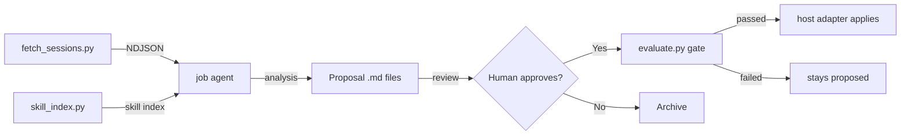

# Skill Evolution

Autonomous self-improvement for your agent skills.

Reads past sessions, analyzes them against loaded skills, generates structured proposals, and optionally auto-applies high-confidence improvements. Host-agnostic: ships adapters for **Hermes** and **Claude Code**, with an extensible `HostAdapter` interface for new hosts.

**No daemons. No external services. No GPU.** Just your host agent, a scheduled job, and Python stdlib.

## Quick Start

**Hermes:**

```bash
# Install the skill
hermes skills install https://raw.githubusercontent.com/Carlo1911/skill-evolution/main/SKILL.md

# Load it
hermes -s skill-evolution

# Run analysis
"Run skill evolution analysis on my recent sessions"
```

**Claude Code:** clone the repo and load the skill as a directory. Set
`SKILL_EVOLUTION_HOST=claude_code` so the read/write adapter routes to `~/.claude`.

The agent will:
1. Fetch unprocessed sessions from the host's session database
2. Scan your installed skills
3. Analyze each session for coverage gaps
4. Generate proposal files in `./proposals/` (override with `SKILL_EVOLUTION_PROPOSALS_DIR`)
5. Deliver a summary

## Auto-Apply (Opt-In)

By default, proposals are review-only. Enable auto-apply:

```bash
export SKILL_EVOLUTION_AUTO_APPLY=true
export SKILL_EVOLUTION_MIN_CONFIDENCE=0.85
```

## Scheduled Runs

This repo doesn't ship a ready-made cron/job prompt — that's operator-specific (how you
schedule it, what it delivers to, which host you're on) and belongs in your own job
configuration, not in this repo. What the job prompt needs to do: run
`scripts/fetch_sessions.py` + `scripts/skill_index.py`, hand the output to an LLM analysis
step using the `SKILL_EVOLUTION_*` env vars to find the right paths, and have it write
proposals following `proposal.py`'s schema. See `SKILL.md`'s "Scheduled Runs (Cron)"
section for the full contract.

## Project Structure

```
skill-evolution/
├── SKILL.md                    # Skill file (installable via host's skill install)
├── README.md                   # This file
├── LICENSE                     # MIT
├── pyproject.toml              # Python package, with `optimizer` and `embeddings` extras
├── scripts/                    # Standalone Python tools
│   ├── fetch_sessions.py       # Read host session database → NDJSON
│   ├── skill_index.py          # Scan skills → JSON index
│   ├── analyze.py              # Format sessions for LLM
│   ├── proposal.py             # Proposal schema, I/O, apply logic
│   ├── host.py                 # Host adapter seam (HermesAdapter, ClaudeCodeAdapter, ...)
│   ├── evaluate.py             # Evaluation gate (deterministic + LLM-judge + regression + opt-in human_review + embedding_similarity)
│   ├── optimize_skill.py       # Optional GEPA optimizer (needs the `gepa` extra)
│   ├── skill_quality.py        # Periodic skill quality tracking and trend reports
│   ├── embedding_backends.py   # FastEmbed / Ollama / OpenAI / llama.cpp embedding backends
│   ├── embedding_similarity.py # Embedding-similarity evaluator (opt-in)
│   ├── state.py                # Track processed sessions (per-host)
│   ├── skill-evolution-fetch.sh # Cron wrapper (Hermes)
│   └── skill-quality-report.sh # Cron wrapper for quality reports
└── tests/                      # pytest suite (one file per evaluator/feature area)

## How It Works



Proposals with confidence above threshold still have to pass the evaluation gate — deterministic size checks (absolute cap, per-pass growth *and* shrink both as a percentage and as an absolute byte count, plus cumulative drift measured against where the skill started), an LLM-judge rubric score, a regression check against that target's own history, and an optional interactive human-rejection veto (`SKILL_EVOLUTION_EVALUATORS=...,human_review`) — before the host adapter runs the mutation.

The absolute cap is a **ratchet**: a skill already over the limit can still be replaced by a body no larger than itself, so an oversized skill stays improvable without ever getting worse, while a *new* skill is never created over the limit. Size comparisons measure against the installed `SKILL.md` on disk, not against the "current value" a proposal reports about itself.

Note that **no automated step applies a proposal.** The analysis run writes proposals and stops; the analyzer prompt forbids it from calling the host's skill-mutation tool whatever the confidence. `apply_proposal()` is invoked by a human, or by a step you write. See `SKILL.md` for the details and `SKILL_EVOLUTION_*` environment variables.

### Host support

Sessions and skills are read through a `HostAdapter` (`scripts/host.py`), selected via
`SKILL_EVOLUTION_HOST` (default `hermes`).

- `HermesAdapter` reads `~/.hermes/state.db` and `~/.hermes/skills/<category>/<skill>/SKILL.md`.
  `apply_proposal()` emits `skill_manage` instruction dicts (`applied_by: agent`).
- `ClaudeCodeAdapter` reads `~/.claude/skills/*/SKILL.md` and `~/.claude/projects/*/*.jsonl`.
  `apply_proposal()` writes skill files directly (`applied_by: direct`), archiving
  deprecate/merge sources under `skills/.archive/`.

A new host implements the `HostAdapter` ABC: three read methods (`iter_sessions`,
`iter_skills`, `read_skill_body`) plus a `supports_write` flag and a concrete
`apply_skill_write(plan)` that returns the host's mutation plan. See `CLAUDE.md` for the
full contract.

### LLM providers

The judge runs against whichever provider you have credentials for — five stdlib-only
adapters, no SDK and no LiteLLM:

| `SKILL_EVOLUTION_PROVIDER` | Needs | Default model |
|---|---|---|
| `claude` (default) | `ANTHROPIC_API_KEY` | `claude-sonnet-5` |
| `ollama` | a local server | `llama3` |
| `opencode` | `OPENCODE_API_KEY` | `big-pickle` |
| `openai` | `OPENAI_API_KEY` | `gpt-4o` |
| `gemini` | `GEMINI_API_KEY` | `gemini-2.0-flash` |

Each evaluator can override the global choice (`SKILL_EVOLUTION_<EVALUATOR>_PROVIDER`), so
the judge can run somewhere different from the optimizer's reflection step. Every prompt is
run through secret redaction and PII masking before it leaves the machine.

### Evaluation targets

The framework scores four independent targets into one shared history file: **skill text**
(gates auto-apply by default), plus **proposal quality**, **tool-call quality**, and
**analyzer-prompt quality** — the last three gate auto-apply only when added to
`SKILL_EVOLUTION_GATE_TARGETS`; by default they are observability-only, inspectable via
`evaluate.py --eval-target` and `optimize_skill.py --list-candidates --target all`. See
`SKILL.md` for the full command reference.

An optional fifth evaluator, **embedding_similarity**, uses vector embeddings for
semantic checks (duplicate detection, drift detection, grounding verification).
It is opt-in via `SKILL_EVOLUTION_EVALUATORS=...,embedding_similarity` and requires
the `embeddings` extra (`pip install -e ".[embeddings]"`).

## Optional: GEPA Optimizer

```bash
pip install -e ".[optimizer]"          # installs gepa==0.1.4
pip install -e ".[embeddings]"         # installs fastembed (for embedding similarity evaluator)
export SKILL_EVOLUTION_OPTIMIZER_ENABLED=true

# Read-only: which targets scored badly enough to be worth optimizing?
python3 scripts/optimize_skill.py --list-candidates

# Run a real gepa.optimize_anything() loop over one skill's session history
python3 scripts/optimize_skill.py --skill <name> [--iterations N]
```

`--skill` seeds GEPA with the skill's installed `SKILL.md`, scores candidates against that
skill's own recorded sessions, and drafts an `improve_existing` proposal from the winner —
through the same review/evaluation gate as any other proposal, never applied directly.

Use the interpreter you installed the extra into: `gepa` is not needed by the rest of the
pipeline, so a bare `python3` without it fails fast with an actionable message.

## Skill Quality Tracking

Periodic quality assessment of all installed skills, using the same rubric as the
evaluation gate. Each skill is scored on correctness, procedure-following, and
conciseness, recorded into `eval_history.jsonl`, and aggregated into a trend report.

```bash
# Evaluate every installed skill and print a markdown report
python3 scripts/skill_quality.py

# Write the report to a file (e.g. for cron)
python3 scripts/skill_quality.py --output reports/skill-quality-2026-08-01.md

# Narrow the run
python3 scripts/skill_quality.py --skill <name>       # one skill
python3 scripts/skill_quality.py --since 30d          # skip skills evaluated in the last 30 days (cost control)
python3 scripts/skill_quality.py --below 0.7          # only skills scoring below the threshold
python3 scripts/skill_quality.py --format json        # JSON instead of markdown
```

Cost is one LLM-judge call per skill (~$0.01–0.05 each), so a large skill tree can add up
fast — schedule weekly or monthly, not daily. The cron wrapper
`scripts/skill-quality-report.sh` writes a timestamped report to `reports/` by default;
override with `SKILL_EVOLUTION_QUALITY_REPORT_DIR`.

## Dependencies

- Python 3.10+
- A supported host (Hermes or Claude Code, or any host implementing `HostAdapter`)
- No pip packages required for the core pipeline
  - `gepa==0.1.4` (**not** `dspy`) is an optional extra for `optimize_skill.py` (`pip install -e ".[optimizer]"`)
  - `fastembed` is an optional extra for the `embedding_similarity` evaluator (`pip install -e ".[embeddings]"`)

## License

MIT
