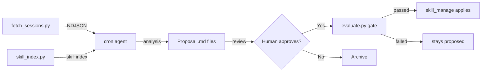

# Hermes Skill Evolution

Autonomous self-improvement for your Hermes Agent skills.

Reads past sessions, analyzes them against loaded skills, generates structured proposals, and optionally auto-applies high-confidence improvements.

**No daemons. No external services. No GPU.** Just Hermes, a cron job, and Python stdlib.

## Quick Start

```bash
# Install the skill
hermes skills install https://raw.githubusercontent.com/<your-user>/hermes-skill-evolution/main/SKILL.md

# Load it
hermes -s hermes-skill-evolution

# Run analysis
"Run skill evolution analysis on my recent sessions"
```

The agent will:
1. Fetch unprocessed sessions from `~/.hermes/state.db`
2. Scan your installed skills
3. Analyze each session for coverage gaps
4. Generate proposal files in `proposals/`
5. Deliver a summary

## Auto-Apply (Opt-In)

By default, proposals are review-only. Enable auto-apply:

```bash
export SKILL_EVOLUTION_AUTO_APPLY=true
export SKILL_EVOLUTION_MIN_CONFIDENCE=0.85
```

## Scheduled Runs

```bash
# Via in-session request:
"Create a daily cron job for skill evolution at 2 AM"

# Or manually:
hermes cron create "0 2 * * *" \
  --name skill-evolution-analysis \
  --skill hermes-skill-evolution \
  --deliver all
```

## Project Structure

```
hermes-skill-evolution/
├── SKILL.md                    # Skill file (installable via hermes skills install)
├── README.md                   # This file
├── LICENSE                     # MIT
├── scripts/                    # Standalone Python tools
│   ├── fetch_sessions.py       # Read Hermes state.db → NDJSON
│   ├── skill_index.py          # Scan skills → JSON index
│   ├── analyze.py              # Format sessions for LLM
│   ├── proposal.py             # Proposal schema, I/O, apply logic
│   ├── evaluate.py             # Evaluation gate (deterministic + LLM-judge + regression)
│   ├── optimize_skill.py       # Optional GEPA-lite optimizer (needs `dspy`)
│   ├── state.py                # Track processed sessions
│   └── skill-evolution-fetch.sh # Cron wrapper
├── tests/                      # pytest suite (one file per evaluator/feature area)
├── docs/                       # Documentation, proposals/, and eval_history.jsonl at runtime
└── proposals/, reports/        # Empty placeholders — actual writes default to docs/skill-evolution/
```

## How It Works



Proposals with confidence above threshold still have to pass the evaluation gate — a deterministic size/growth/YAML check, an LLM-judge rubric score, and a regression check against that target's own history — before `skill_manage` is ever called. See `SKILL.md` for the details and `SKILL_EVOLUTION_*` environment variables.

## Optional: GEPA-lite Optimizer

```bash
pip install -e ".[optimizer]"
export SKILL_EVOLUTION_OPTIMIZER_ENABLED=true
python3 scripts/optimize_skill.py
```

Scans the evaluation history for low-scoring targets and drafts `improve_existing` proposals for them — through the same review/evaluation gate as any other proposal, never auto-applied directly.

## Dependencies

- Python 3.10+
- Hermes Agent (any version)
- No pip packages required for the core pipeline; `dspy` is an optional extra for `optimize_skill.py` (`pip install -e ".[optimizer]"`)

## License

MIT
