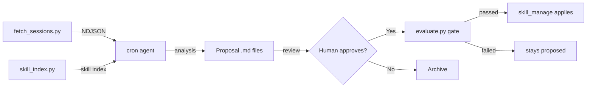

# Hermes Skill Evolution

Autonomous self-improvement for your Hermes Agent skills.

Reads past sessions, analyzes them against loaded skills, generates structured proposals, and optionally auto-applies high-confidence improvements.

**No daemons. No external services. No GPU.** Just Hermes, a cron job, and Python stdlib.

## Quick Start

```bash
# Install the skill
hermes skills install https://raw.githubusercontent.com/Carlo1911/skill-evolution/main/SKILL.md

# Load it
hermes -s hermes-skill-evolution

# Run analysis
"Run skill evolution analysis on my recent sessions"
```

The agent will:
1. Fetch unprocessed sessions from `~/.hermes/state.db`
2. Scan your installed skills
3. Analyze each session for coverage gaps
4. Generate proposal files in `docs/skill-evolution/proposals/`
5. Deliver a summary

## Auto-Apply (Opt-In)

By default, proposals are review-only. Enable auto-apply:

```bash
export SKILL_EVOLUTION_AUTO_APPLY=true
export SKILL_EVOLUTION_MIN_CONFIDENCE=0.85
```

## Scheduled Runs

```bash
# Via in-session request:
"Create a daily cron job for skill evolution at 2 AM"

# Or manually:
hermes cron create "0 2 * * *" \
  --name skill-evolution-analysis \
  --skill hermes-skill-evolution \
  --deliver all
```

## Project Structure

```
hermes-skill-evolution/
├── SKILL.md                    # Skill file (installable via hermes skills install)
├── README.md                   # This file
├── LICENSE                     # MIT
├── scripts/                    # Standalone Python tools
│   ├── fetch_sessions.py       # Read Hermes state.db → NDJSON
│   ├── skill_index.py          # Scan skills → JSON index
│   ├── analyze.py              # Format sessions for LLM
│   ├── proposal.py             # Proposal schema, I/O, apply logic
│   ├── evaluate.py             # Evaluation gate (deterministic + LLM-judge + regression)
│   ├── optimize_skill.py       # Optional GEPA optimizer (needs the `gepa` extra)
│   ├── state.py                # Track processed sessions
│   └── skill-evolution-fetch.sh # Cron wrapper
├── tests/                      # pytest suite (one file per evaluator/feature area)
├── docs/                       # Documentation, proposals/, and eval_history.jsonl at runtime
└── proposals/, reports/        # Empty placeholders — actual writes default to docs/skill-evolution/
```

## How It Works



Proposals with confidence above threshold still have to pass the evaluation gate — deterministic size checks (absolute cap, per-pass growth *and* shrink both as a percentage and as an absolute byte count, plus cumulative drift measured against where the skill started), an LLM-judge rubric score, and a regression check against that target's own history — before `skill_manage` is ever called.

The absolute cap is a **ratchet**: a skill already over the limit can still be replaced by a body no larger than itself, so an oversized skill stays improvable without ever getting worse, while a *new* skill is never created over the limit. Size comparisons measure against the installed `SKILL.md` on disk, not against the "current value" a proposal reports about itself.

Note that **no automated step applies a proposal.** The analysis run writes proposals and stops; the analyzer prompt forbids it from calling `skill_manage` whatever the confidence. `apply_proposal()` is invoked by a human, or by a step you write. See `SKILL.md` for the details and `SKILL_EVOLUTION_*` environment variables.

### LLM providers

The judge runs against whichever provider you have credentials for — five stdlib-only
adapters, no SDK and no LiteLLM:

| `SKILL_EVOLUTION_PROVIDER` | Needs | Default model |
|---|---|---|
| `claude` (default) | `ANTHROPIC_API_KEY` | `claude-sonnet-5` |
| `ollama` | a local server | `llama3` |
| `opencode` | `OPENCODE_API_KEY` | `big-pickle` |
| `openai` | `OPENAI_API_KEY` | `gpt-4o` |
| `gemini` | `GEMINI_API_KEY` | `gemini-2.0-flash` |

Each evaluator can override the global choice (`SKILL_EVOLUTION_<EVALUATOR>_PROVIDER`), so
the judge can run somewhere different from the optimizer's reflection step. Every prompt is
run through secret redaction and PII masking before it leaves the machine.

### Evaluation targets

The framework scores four independent targets into one shared history file: **skill text**
(the only one that gates auto-apply), plus **proposal quality**, **tool-call quality**, and
**analyzer-prompt quality** — the last three are observability-only, inspectable via
`evaluate.py --eval-target` and `optimize_skill.py --list-candidates --target all`. See
`SKILL.md` for the full command reference.

## Optional: GEPA Optimizer

```bash
pip install -e ".[optimizer]"          # installs gepa==0.1.4
export SKILL_EVOLUTION_OPTIMIZER_ENABLED=true

# Read-only: which targets scored badly enough to be worth optimizing?
python3 scripts/optimize_skill.py --list-candidates

# Run a real gepa.optimize_anything() loop over one skill's session history
python3 scripts/optimize_skill.py --skill <name> [--iterations N]
```

`--skill` seeds GEPA with the skill's installed `SKILL.md`, scores candidates against that
skill's own recorded sessions, and drafts an `improve_existing` proposal from the winner —
through the same review/evaluation gate as any other proposal, never applied directly.

Use the interpreter you installed the extra into: `gepa` is not needed by the rest of the
pipeline, so a bare `python3` without it fails fast with an actionable message.

## Dependencies

- Python 3.10+
- Hermes Agent (any version)
- No pip packages required for the core pipeline; `gepa==0.1.4` (**not** `dspy`) is an optional extra for `optimize_skill.py` (`pip install -e ".[optimizer]"`)

## License

MIT
