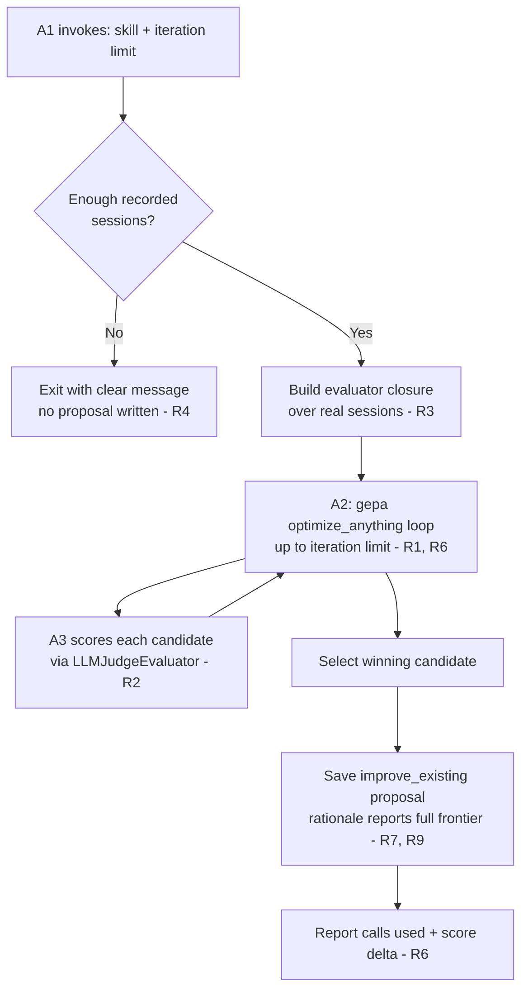
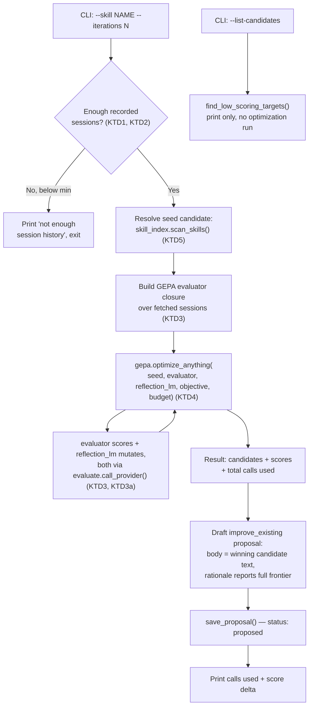

# Real GEPA Optimizer - Plan

## Goal Capsule

- **Objective:** Replace `optimize_skill.py`'s placeholder proposal drafting with a real multi-round GEPA optimizer (standalone `gepa` package) that runs the actual reflective-mutation-and-Pareto-selection loop against a skill's real recorded sessions, invoked explicitly per skill.
- **Product authority:** Session-settled through direct dialogue with the repo owner on 2026-07-24. This plan owns one area split from a broader gap-analysis request — the other six candidate areas (more evaluation targets, more providers, a human-in-the-loop evaluator, skill quality tracking, production cron migration, heavier evaluation techniques) are not active scope here; see "How This Work Fits Together."
- **Open blockers:** None. The standalone `gepa` package's existence and dependency footprint were verified directly (PyPI, v0.1.4, released 2026-07-15; base install requires neither `dspy` nor `langchain`). The exact adapter shape between `gepa`'s evaluator callable and `evaluate.py`'s `LLMJudgeEvaluator` is deferred to planning.

---

## Product Contract

### Summary

Give `hermes-skill-evolution` a real GEPA optimizer: explicit `--skill`/`--iterations` invocation runs the actual `gepa` (standalone PyPI package) reflective-mutation-and-Pareto-selection loop against a skill's real recorded sessions, replacing today's placeholder that pastes evaluator feedback back as fake proposal text. Output stays a normal proposal that must clear the existing evaluation gate — GEPA never bypasses it.

### Problem Frame

Today `scripts/optimize_skill.py` finds skills with low aggregate scores in `eval_history.jsonl` and drafts an `improve_existing` proposal whose `proposed_changes[0].new_value` is literally the string `"Address this feedback and revise: {feedback}"` — not a rewritten skill body, just the evaluator's complaint pasted back. Despite being named "GEPA-lite" in its own module docstring and described that way in this repo's `CLAUDE.md`, it never imports or calls the GEPA algorithm at all: no reflective mutation, no candidate generation, no Pareto selection, no multi-round iteration. `pyproject.toml`'s `optimizer`/`dspy` extras (`dspy>=3.0.0`) exist for this purpose, and `_require_dspy()` gates on `dspy` being importable, but no code path actually calls into it. The gap between what the module claims to be and what it does is the reason this plan exists.

### Requirements

**Optimization engine**

- R1. The optimizer runs the real GEPA algorithm (reflective mutation and Pareto-based candidate selection across multiple rounds) via the standalone `gepa` PyPI package's `optimize_anything`-shaped API — not a hand-rolled reimplementation, and not `dspy.GEPA`.
- R2. GEPA's evaluator callable reuses `evaluate.py`'s existing `LLMJudgeEvaluator` scoring (or an evaluator built on the same provider-adapter layer) rather than introducing a second, parallel scoring mechanism.
- R3. The trainset/evaluation basis for a given optimization run is built from that skill's real recorded sessions (the same `~/.hermes/state.db` data `fetch_sessions.py` already reads) — no synthetic dataset generation, and no dependency on a dataset-builder component that doesn't exist yet.
- R4. When a skill has too few recorded sessions to form a usable evaluation basis, the optimizer exits cleanly with a clear message rather than attempting to optimize against a near-empty trainset.

**Invocation and cost control**

- R5. The optimizer is invoked explicitly for one named skill at a time (skill name plus iteration count), not by auto-scanning every low-scoring target in a single run.
- R6. Each run enforces a configurable hard limit on iterations/LLM calls, and reports how many calls it made and the resulting score delta (e.g. "score improved from 0.72 to 0.81") when it finishes.

**Output and gating**

- R7. The optimizer's output is a normal `SkillEvolutionProposal` (`type=improve_existing`) saved through the existing `save_proposal()` path — it is never applied directly.
- R8. An optimizer-produced proposal passes through the exact same evaluation gate as any other proposal before it can auto-apply; there is no separate or relaxed gate for optimizer-originated proposals.
- R9. The proposal's rationale reports the explored candidate set from the run — how many candidates GEPA considered, why the chosen one won, and what trade-off the runner-up made — rather than collapsing to only the final winning score.

**Dependency**

- R10. The optional dependency for this feature is the standalone `gepa` PyPI package, installed via the existing optional-extra mechanism this repo already uses for opt-in dependencies (the same posture as today's `dspy`/`optimizer` extras) — not the full `dspy` framework.

**Candidate discovery**

- R11. The existing low-score-scanning logic is retained as a read-only "candidates" report (e.g. a `--list-candidates`-style mode) that surfaces skills scoring below threshold, without triggering an optimization run — it no longer auto-runs the optimizer against every result the way today's `run_optimizer()` does.

### Key Decisions

- KD1. **Standalone `gepa` package over `dspy.GEPA`.** Same real algorithm (reflective mutation plus Pareto selection); the base install requires neither `dspy` nor `langchain`, confirmed directly against PyPI (`gepa` v0.1.4, released 2026-07-15) and the project's GitHub README (`optimize_anything` optimizes a plain-text candidate string via an evaluator callable, no DSPy module wrapping needed). *(session-settled: user-directed — the user pushed back on an initial recommendation to adopt `dspy.GEPA` and asked for verification of a lighter alternative before deciding; the standalone package was confirmed to exist and fit before being accepted.)* Governs R1, R10.
- KD2. **Real recorded sessions as the trainset, not a synthetic dataset.** Avoids a hard dependency on the not-yet-built synthetic dataset builder (a separate candidate area, see below), at the cost of noisier, non-curated evaluation signal compared to purpose-built examples. *(session-settled: user-directed.)* Governs R3.
- KD3. **Explicit per-skill invocation, not auto-scan-all.** Given real per-run LLM cost for multi-round optimization, the user chose deliberate, one-skill-at-a-time invocation over the current auto-scan-every-low-scorer behavior. *(session-settled: user-directed.)* Governs R5.
- KD4. **Hard configurable cost/iteration limit with a completion report**, rather than unlimited iteration or a manual iteration count with no reporting. *(session-settled: user-directed.)* Governs R6.
- KD5. **Report the full explored-candidate picture in the proposal rationale, not just the winning score.** Costs little given the run already computes it, and gives the human reviewer more to evaluate before approving. *(session-settled: user-directed.)* Governs R9.
- KD6. **Repurpose today's auto-scan as a read-only candidates report, rather than deleting it or leaving it running the optimizer automatically.** Preserves the low-score-discovery signal `find_low_scoring_targets()` already provides while still requiring the explicit `--skill` invocation KD3 established. *(session-settled: user-directed.)* Governs R11.

### How This Work Fits Together
<!-- ce-section: work-relationships -->

This plan owns the real-GEPA-optimizer area only. It came out of a broader gap analysis against two existing planning documents (`docs/plans/2026-07-23-001-feat-skill-evolution-evaluation-plan.md` and `docs/integration-plan.md`) that surfaced seven pending areas; the user chose this one as the current focus. The breakdown below is the current understanding, not a committed roadmap — a later brainstorm may revise, split, merge, or discard any of it.

- Evaluation coverage expansion (proposal quality, tool-call quality, analyzer-prompt quality evaluation targets — the evaluation plan's R5 fast-follow scope) — `Can proceed independently of` this plan; shares the evaluator registry and gate this plan reuses but adds no dependency on GEPA.
- Provider coverage expansion (OpenAI, Gemini, MiniMax, Kimi K2 adapters — the evaluation plan's R7 fast-follow scope) — `Can proceed independently of` this plan; `Enables` a future choice to run GEPA's evaluator against a non-Claude/Ollama provider, but this plan does not require it.
- Human-in-the-loop evaluator (deferred from the evaluation plan's R3) — `Can proceed independently of` this plan.
- Skill quality tracking / synthetic dataset builder (`docs/integration-plan.md` Fase 2: `dataset_builder.py`, `skill_quality.py`) — `Can proceed independently of` this plan. This plan explicitly does not depend on it (KD2): GEPA's trainset comes from real sessions instead.
- Production cron migration (pointing the real `~/.hermes/cron/jobs.json` at this repo instead of `ai-memory-stack` — the evaluation plan's R16) — `Still to decide` when; the original plan gates it on the shared-core evaluators completing clean retroactive runs, a condition unrelated to whether GEPA specifically has shipped.
- Heavier evaluation techniques (pairwise/win-rate comparison, debate/ensemble judging, execution-based re-run verification, embedding-similarity checks, fine-tuned local judges — catalogued and deliberately deferred in the evaluation plan's Scope Boundaries) — `Still to decide`; not reconsidered as part of this plan.

### Actors

- A1. CLI operator (the repo owner) — invokes the optimizer for one named skill with an iteration count.
- A2. GEPA optimization loop (`gepa` package) — runs reflective-mutation-and-Pareto-selection rounds up to the configured limit.
- A3. Evaluation subsystem (`evaluate.py`'s `LLMJudgeEvaluator`/provider adapter) — scores each candidate; reused as GEPA's metric callable (R2).

### Key Flows

- F1. Explicit GEPA optimization run
  - **Trigger:** A1 invokes the optimizer for a named skill with an iteration count.
  - **Actors:** A1, A2, A3
  - **Steps:** Load that skill's recorded sessions → if too few to form a usable evaluation basis, exit with a clear message and write no proposal (R4) → otherwise build the evaluator closure over those sessions (R3) → A2 runs the GEPA loop against A3's scoring, up to the configured iteration/call limit (R6) → select the winning candidate from the explored set → draft and save a normal `improve_existing` proposal carrying the full explored-candidate picture in its rationale (R7, R9) → report iterations used and the resulting score delta.
  - **Covers:** R1, R2, R3, R4, R5, R6, R7, R9



### Acceptance Examples

- AE1. **Covers R4.** Given a skill with 0-1 recorded sessions, When the optimizer is invoked for that skill, Then it exits with a clear "not enough session history" message and writes no proposal.
- AE2. **Covers R6, R7.** Given the configured iteration/call limit is reached before convergence, When the run stops, Then it saves a proposal built from the best candidate found so far and reports the number of calls made and the resulting score delta.
- AE3. **Covers R8.** Given an optimizer-produced proposal scores below the LLM-judge threshold when evaluated, When a human approves it and `apply_proposal()` runs, Then auto-apply is blocked exactly as it would be for an analyst-authored proposal — no special-cased bypass.

### Scope Boundaries

**Deferred for later**

- All six areas listed above in "How This Work Fits Together."
- Exact iteration/cost limit default values, and the minimum session count below which R4's clean-exit fires — planning-level detail, not decided here.

### Outstanding Questions

**Deferred to Planning**

- Exact shape of the adapter between `gepa`'s evaluator-callable contract and `evaluate.py`'s `LLMJudgeEvaluator` (R2) — confirmed compatible in principle (plain-text candidate in, float score plus logged feedback out) but not designed here.
- Default values for R6's iteration/cost limit and R4's minimum-session threshold.
- Exact `pyproject.toml` extra name and dependency spec change from `dspy>=3.0.0` to `gepa` (R10).
- Exact CLI surface for R11's candidates report (flag name, output format).

### Dependencies / Assumptions

- Assumes the standalone `gepa` PyPI package (v0.1.4 as of 2026-07-15) remains available and its base install continues to exclude `dspy`/`langchain` as mandatory dependencies — confirmed via direct PyPI/GitHub lookup on 2026-07-24, not from training-data recall.
- Assumes `~/.hermes/state.db` continues to expose enough per-skill session history for R3's real-session trainset to be usable for actively-used skills — already an assumption of the parent evaluation plan.

### Sources / Research

- `scripts/optimize_skill.py` — confirmed the placeholder `draft_proposal_for_target()` behavior (`new_value=f"Address this feedback and revise: {feedback}"`) and the existing `find_low_scoring_targets()`/`run_optimizer()` auto-scan flow this plan's R5 changes.
- `docs/plans/2026-07-23-001-feat-skill-evolution-evaluation-plan.md` — source of R14/R15 (the optimizer must not bypass the gate) and the deferred-scope catalog this plan's "How This Work Fits Together" draws from.
- `docs/integration-plan.md` — source of the Fase 2 (dataset builder/quality tracker) and Fase 3 (GEPA) framing; confirmed Fase 2 is unbuilt (no `dataset_builder.py`/`skill_quality.py` in `scripts/`).
- [gepa · PyPI](https://pypi.org/project/gepa/) — confirmed v0.1.4 (2026-07-15), Python `>=3.10,<3.15`, base install excludes `dspy`/`langchain`.
- [gepa-ai/gepa on GitHub](https://github.com/gepa-ai/gepa) — confirmed `optimize_anything`'s plain-text-candidate-plus-evaluator-callable API shape, no DSPy module wrapping required.
- `gepa-ai/gepa`'s `docs/docs/guides/quickstart.md` and its `src/gepa/optimize_anything.py` source — confirmed `optimize_anything(seed_candidate, evaluator, objective, ...)`'s general shape, the evaluator's `(score, feedback_dict)` return option, a result object carrying `val_aggregate_scores`/`total_metric_calls`, and two budget-control shapes: the quickstart's legacy `GEPAConfig(engine=EngineConfig(max_metric_calls=N))` and the source's current `OptimizeAnythingConfig(max_evals=N)` (auto-converted from the legacy form) — see KTD4 for what this means for U3's wiring.
- `~/.hermes/state.db` schema (`messages.tool_calls`) — confirmed live, via direct query, that tool calls are recorded as JSON including `skill_view`/`skill_manage` entries with a `{"function": {"name": ..., "arguments": "{\"name\": \"<skill>\"}"}}` shape, giving a reliable session-to-skill linkage for R3's trainset query.
- `scripts/evaluate.py` — `LLMJudgeEvaluator`'s prompt-boundary framing (`_build_prompt`) and strict response validation (`_parse_response`) are the pattern the new GEPA evaluator (KTD3) mirrors; `call_provider()`/`redact_secrets()` are reused directly.
- `scripts/skill_index.py` — `scan_skills()` is the existing name-to-`SKILL.md`-path resolver reused for GEPA's seed candidate (KTD5); note it returns `{name, category, description, path, size}` only — resolving the seed candidate's body text requires an additional read of the file at `path`.
- Doc review (confidence check, 2026-07-24) — three independent reviewers (feasibility, security-lens, adversarial) installed and inspected the actual `gepa==0.1.4` package rather than relying on hosted docs, and found `ReflectionConfig.reflection_lm` defaults to `"openai/gpt-5.1"` via a `litellm`-backed wrapper not present in the base install (KTD3a), and that `OptimizeAnythingConfig`/`max_evals` (KTD4's original claim) do not exist in that release. Both corrections are reflected in KTD3a and KTD4 above; the installed-package inspection method is more reliable than this plan's earlier hosted-doc research and is worth repeating at implementation time given `gepa`'s pre-1.0 pace of change.
- `~/.hermes/state.db` (direct query, doc review) — confirmed `sessions.started_at`/`messages.timestamp` are the live column names; `fetch_sessions.py`'s own `SESSION_QUERY`/`MESSAGE_QUERY` reference `created_at` (both tables) and `total_tokens` (sessions), none of which exist in the live schema — a pre-existing defect in `fetch_sessions()` this plan's U1 does not inherit (see U1's Approach).

---

## Planning Contract

**Product Contract preservation:** Unchanged in this enrichment pass — no R/KD IDs were added, removed, or renumbered relative to the brainstorm output. This section, Implementation Units, Verification Contract, and Definition of Done are additive.

### Key Technical Decisions

- KTD1. **Skill-scoped session query is a new function alongside `fetch_sessions()`, not a variant of it.** `fetch_sessions()`'s incremental/mark-processed/lookback-window design serves the cron pipeline; GEPA needs a skill's full recorded history on demand, with no processed-state side effects. It reuses the same state.db connection pattern, `contains_secret()` redaction, and message-truncation shape. *(session-settled: user-directed — real sessions as the trainset source, chosen over a synthetic dataset builder.)* Governs R3, R4.
- KTD2. **Session-to-skill linkage is via `messages.tool_calls` `skill_view`/`skill_manage` entries naming the skill**, confirmed against the live `state.db` schema (a `tool_calls` JSON column already carries `{"function": {"name": "skill_view", "arguments": "{\"name\": \"<skill>\"}"}}` entries), rather than a full-text search over message content, which would false-positive on any message that merely mentions the skill's name in prose. Governs R3.
- KTD3. **The GEPA evaluator is a new prompt/adapter built on `evaluate.py`'s provider-adapter layer (`call_provider`, `redact_secrets`, the per-call random-boundary untrusted-content framing), not a direct call to `LLMJudgeEvaluator.evaluate()`.** The existing judge scores a proposal's text in isolation; GEPA's evaluator must score a candidate against the fetched session evidence (KTD1), which the existing rubric prompt has no place for. *(session-settled: user-directed — real recorded sessions as the scoring basis.)* Governs R2, R3.
- KTD3a. **`gepa`'s reflective-mutation step (the LLM that proposes each new candidate, distinct from the scoring evaluator) is also wired through `evaluate.call_provider()`/`redact_secrets()`, not left on `gepa`'s own default.** Confirmed by installing and inspecting `gepa==0.1.4`: `ReflectionConfig.reflection_lm` defaults to `"openai/gpt-5.1"`, resolved via a `litellm`-based wrapper; `litellm` ships only under `gepa`'s `full` extra, not the base install U6 depends on. Left unconfigured, a real run either raises an import error or silently requires an unconfigured `OPENAI_API_KEY`, and — more importantly — routes session-derived content through a call path with no `redact_secrets()` step, undermining the same untrusted-content/redaction discipline KTD3 exists to uphold on the evaluator side. *(Surfaced by independent doc-review findings from feasibility, security-lens, and adversarial review — corroborated via direct inspection of the installed package, not just its docs.)* Governs R1, R2.
- KTD4. **`optimize_anything(seed_candidate, evaluator, objective, config)` returns a result object carrying `val_aggregate_scores` and `total_metric_calls`**; the evaluator may return `(score, feedback_dict)` directly, matching `EvalResult`'s score+feedback shape with no extra translation layer. Budget control is `GEPAConfig(engine=EngineConfig(max_metric_calls=N))` — confirmed by installing and inspecting the actual `gepa==0.1.4` package (not just its docs): no `OptimizeAnythingConfig` class or `max_evals` parameter exists anywhere in that release; `EngineConfig.max_metric_calls` is the only budget knob. (An earlier draft of this KTD, based on reading GitHub docs rather than the pinned release, wrongly called this shape "legacy" against a newer form that isn't actually installable at 0.1.4 — corrected during doc review.) **Implementation-time decision, not resettled here:** whether U2's evaluator closes over the sessions internally or the sessions are passed as `dataset`/`valset` — confirm against the actually-installed `gepa` version before wiring U3. Governs R1, R6.
- KTD5. **Seed candidate resolution reuses `skill_index.scan_skills()`** to map a skill name to its installed `SKILL.md` path and current body — the same mechanism `evaluate.py`'s `DeterministicEvaluator` already relies on for baseline size — rather than reading proposal history for a prior version. Governs R1.
- KTD6. **CLI surface is `--skill`/`--iterations` for the explicit run and `--list-candidates` for the read-only report**, replacing today's argument-free `main()` that scans and optimizes every low-scoring target unconditionally. *(session-settled: user-directed — explicit per-skill invocation over auto-scan-all; repurpose the scan as a read-only report over deleting it.)* Governs R5, R11.
- KTD7. **The optional dependency is renamed from `dspy` to the standalone `gepa` package** in `pyproject.toml`'s `optimizer` extra; the now-unused `dspy` extra alias is dropped since nothing else in the repo imports `dspy`. *(session-settled: user-directed — standalone `gepa` over `dspy.GEPA`, verified against PyPI before commit.)* Governs R10.

### Assumptions

- Default minimum session count for R4's clean-exit threshold: 3. Below this, the optimizer reports "not enough session history" and writes no proposal.
- Default iteration/call limit for R6: a modest fixed value (e.g. 20 `max_metric_calls`), overridable per-run by `--iterations` and globally by an env var following the `SKILL_EVOLUTION_OPTIMIZER_<NOUN>` convention. Exact default is a judgment call, not a user-specified number — revisit if real runs show it's too tight or too loose.

### Risks & Dependencies

- **Session excerpts crossing the external-provider boundary get only `SECRET_PATTERNS`-level redaction.** U2's evaluator (and KTD3a's reflection adapter) send real session content to Claude/Ollama via `evaluate.call_provider()`, which redacts known secret-key patterns but not PII or other sensitive conversation content. Every prior `call_provider()` caller only ever sent proposal/skill text, not raw session transcripts — this is a materially new exposure surface. Not resolved in this plan; flagged for explicit sign-off before U2 ships (doc-review finding, security-lens).
- **U2's evaluator hand-copies `LLMJudgeEvaluator`'s boundary-framing and validation logic instead of extracting shared helpers.** Two independent copies of the per-call random-boundary untrusted-content framing and strict JSON validation will drift if one is patched without the other. Not resolved in this plan; the implementer should judge whether to extract shared helpers in `evaluate.py` before or during U2 (doc-review finding, scope-guardian).

### High-Level Technical Design



Later, independent of this flow: a human approves a saved proposal and `apply_proposal()` runs the existing evaluation gate exactly as it does for any proposal (R8) — no step in this diagram bypasses it.

---

## Implementation Units

### U1. Skill-scoped session query

**Goal:** Given a skill name, return that skill's full recorded session history — not gated by the cron pipeline's processed-state or lookback window.

**Requirements:** R3, R4 (per KTD1, KTD2)

**Dependencies:** None

**Files:**
- `scripts/fetch_sessions.py` (add function)
- `tests/test_fetch_sessions_for_skill.py` (new)

**Approach:**
- Add `sessions_for_skill(skill_name, db_path=DEFAULT_DB_PATH) -> List[Dict]`.
- Query `messages.tool_calls` via `json_each` for entries where the function name is `skill_view` or `skill_manage` and the call arguments name `skill_name` (KTD2); collect the distinct owning `session_id`s.
- Pull full session and message data for those IDs, reusing `fetch_sessions()`'s `source != 'cron'` exclusion, secret redaction (`contains_secret()`), and message-truncation shape for consistency — but select against the live `state.db` schema's actual columns (`sessions.started_at`, `messages.timestamp`; `sessions` has no `total_tokens` column), not `fetch_sessions()`'s own `SESSION_QUERY`/`MESSAGE_QUERY` verbatim, which reference `created_at`/`total_tokens` columns that do not exist in the live schema (doc-review finding, verified directly against `~/.hermes/state.db`). Flag this as a pre-existing defect in `fetch_sessions()` itself, out of this plan's stated scope to fix.
- No `mark_processed()` call and no interaction with the cron pipeline's state file — this function has no side effects.

**Patterns to follow:** `fetch_sessions.py`'s existing `fetch_sessions()` for connection/redaction style — but not its `SESSION_QUERY`/`MESSAGE_QUERY` column list verbatim (see above).

**Test scenarios:**
- Happy path: a skill invoked via `skill_view` in 3 sessions returns exactly those 3 sessions.
- Happy path: a skill invoked via `skill_manage` (not `skill_view`) is also matched.
- Edge: a skill never invoked returns an empty list, not an error.
- Error path: message content matching `SECRET_PATTERNS` is redacted the same way `fetch_sessions()` already redacts it.
- Regression: the query runs successfully against a fixture schema matching the live `state.db` columns (`started_at`, `timestamp`), not the column names `fetch_sessions()`'s own query currently (incorrectly) uses.
- Integration: sessions with `source == 'cron'` are excluded, consistent with `fetch_sessions()`'s existing pipeline-noise exclusion.

**Verification:** Running the function against a fixture SQLite database with known `tool_calls` entries returns exactly the expected session set.

### U2. GEPA candidate-scoring evaluator

**Goal:** A callable matching `gepa`'s evaluator contract that scores a candidate skill-body string against a skill's fetched sessions.

**Requirements:** R2, R9 (per KTD3)

**Dependencies:** U1

**Files:**
- `scripts/optimize_skill.py` (add function)
- `tests/test_optimize_skill_evaluator.py` (new)

**Approach:**
- Build a prompt embedding session excerpts (U1) as untrusted data using the same per-call random-boundary technique as `LLMJudgeEvaluator._build_prompt`, plus the candidate skill body, asking the judge to score `correctness`/`procedure_following`/`conciseness` against the observed session patterns, returning the same JSON shape as today's judge.
- Call `evaluate.call_provider()` directly for the request — same redaction, provider resolution, and per-evaluator override support as the existing judge.
- Parse and validate the response with the same strict rules as `LLMJudgeEvaluator._parse_response` (missing keys, out-of-range values, non-JSON output all fail closed).
- Return `(score, {"feedback": feedback_text})`, matching `gepa`'s evaluator contract (KTD4).

**Patterns to follow:** `scripts/evaluate.py`'s `LLMJudgeEvaluator` — untrusted-content boundary framing, strict JSON validation, fail-closed on error.

**Test scenarios:**
- Happy path: a well-formed judge response produces `(score, {"feedback": ...})` with the expected score.
- Edge (mirrors R20's existing coverage): session excerpts containing embedded instruction-like text do not alter the parsed score.
- Error path: a malformed or missing-key response fails closed with `score = 0.0`, not an exception propagated into `gepa`'s loop.
- Integration: a provider call failure (`ProviderError`) is caught and treated as a failing score, not raised.

**Verification:** A fixture with a deliberately malformed judge response is confirmed to score 0.0 rather than raising or silently passing.

### U3. Core GEPA optimization run

**Goal:** Wire seed-candidate resolution, session fetch, the evaluator, and `gepa.optimize_anything` into one run function with a configurable call/iteration limit.

**Requirements:** R1, R2, R4, R5, R6 (per KTD1, KTD3a, KTD4, KTD5)

**Dependencies:** U1, U2

**Files:**
- `scripts/optimize_skill.py` (add `run_gepa_optimization(skill_name, iterations=None)`, add `_require_gepa()`, delete `_require_dspy()`)
- `tests/test_optimize_skill.py` (extend)

**Approach:**
1. Resolve `skill_name` to its installed `SKILL.md` path and current body via `skill_index.scan_skills()` (KTD5) — this is the seed candidate.
2. Run U1's session query; if the count is below the configured minimum (Assumptions), return a clean "not enough session history" result without calling `gepa` (R4).
3. Build U2's evaluator closure bound to the fetched sessions.
4. Call `gepa.optimize_anything(...)` with the seed candidate, U2's evaluator, an objective string, a call/iteration budget (<configured limit, overridable by `--iterations`>) (KTD4), and an explicit `reflection_lm` wired through `evaluate.call_provider()`/`redact_secrets()` (KTD3a) — never `gepa`'s own litellm/OpenAI default.
5. Return the result object (candidates explored, scores, total calls used) to the caller.

**Patterns to follow:** `optimize_skill.py`'s existing `_require_dspy()` — lazy import with a clear, actionable error message — mirrored as `_require_gepa()`.

**Deferred to implementation (per KTD4):** confirm against the installed `gepa` version whether the fetched sessions are passed as an explicit `dataset`/`valset` argument or closed over inside U2's evaluator — both reach the same engine, but the exact call shape isn't pinned in this plan.

**Technical design (directional):**
```
run_gepa_optimization(skill_name, iterations=None):
    seed = resolve_seed_candidate(skill_name)          # KTD5
    sessions = sessions_for_skill(skill_name)           # U1
    if len(sessions) < MIN_SESSIONS:
        return NotEnoughHistoryResult(skill_name, len(sessions))
    evaluator = build_gepa_evaluator(sessions)           # U2 (or pass sessions via dataset/valset -- KTD4)
    reflection_lm = build_reflection_lm_adapter()         # KTD3a -- never gepa's own litellm/OpenAI default
    budget = iterations or DEFAULT_MAX_CALLS
    return gepa.optimize_anything(seed, evaluator=evaluator, objective=OBJECTIVE,
                                   reflection_lm=reflection_lm, ...budget...)
```

**Test scenarios:**
- Happy path: a skill with sufficient session history and a stubbed `gepa` call returns a result object carrying candidate scores and the total call count.
- Edge (Covers AE1): a skill with 0-1 sessions returns the clean "not enough history" result without calling `gepa`.
- Edge (Covers AE2): a stubbed `gepa` call that reports it stopped at the configured call budget still returns a usable winning candidate.
- Integration (KTD3a): the `gepa.optimize_anything(...)` call is constructed with an explicit `reflection_lm` argument built on `evaluate.call_provider()`, not left absent (which would fall through to `gepa`'s own litellm/OpenAI default).
- Error path: the `gepa` package not installed produces a clear, actionable error message (mirrors today's `_require_dspy()` message shape), not a bare `ImportError`.

**Verification:** A fixture run with a stubbed `gepa.optimize_anything` confirms the seed candidate, evaluator, and config are constructed as designed, and that the not-enough-history path never reaches the stub.

### U4. Proposal drafting with full-frontier rationale

**Goal:** Replace the placeholder proposal body with the real optimized candidate, and report the explored-candidate picture in the rationale.

**Requirements:** R7, R9

**Dependencies:** U3

**Files:**
- `scripts/optimize_skill.py` (replace `draft_proposal_for_target()`)
- `tests/test_optimize_skill.py`

**Approach:**
- Build `proposed_changes=[ProposedChange(field="body", new_value=<winning candidate text>)]`.
- Rationale text reports the number of candidates explored (from the result object's per-candidate scores), the winning score, and the runner-up's score/trade-off (R9).
- Continue calling only `save_proposal()` (never `apply_proposal()`) — this invariant is unchanged from today.

**Patterns to follow:** Today's `draft_proposal_for_target()` for the surrounding `SkillEvolutionProposal` construction shape.

**Test scenarios:**
- Happy path: the proposal's `proposed_changes[0].new_value` is the optimized candidate text, not a placeholder string.
- Happy path (Covers R9): the rationale names the number of candidates explored and the winning vs. runner-up score.
- Regression (Covers AE3): an optimizer-produced proposal still passes through `apply_proposal()`'s evaluation gate with no bypass — same invariant as today's `test_optimizer_proposal_goes_through_same_gate_no_bypass`.

**Verification:** A fixture result object with 3+ candidates produces a proposal whose rationale text distinguishes the winner from at least one runner-up.

### U5. CLI surface: explicit invocation + candidates report

**Goal:** Replace the auto-scan-and-run `main()` with `--skill`/`--iterations` explicit invocation and a `--list-candidates` read-only report.

**Requirements:** R5, R11 (per KTD6)

**Dependencies:** U3, U4

**Files:**
- `scripts/optimize_skill.py` (`main()`/argparse)
- `tests/test_optimize_skill.py`

**Approach:**
1. `argparse` gains `--skill` (str), `--iterations` (int, optional), `--list-candidates` (flag).
2. `--list-candidates` prints `find_low_scoring_targets()`'s entries (target, score, feedback) and exits — no optimization run, no proposal written (R11).
3. `--skill` (with optional `--iterations`) runs U3+U4's flow for exactly that skill and reports the call count and score delta (R6) to stdout.
4. Remove the old unconditional "scan and optimize every low-scoring target" behavior; `SKILL_EVOLUTION_OPTIMIZER_ENABLED` still gates both modes.

**Patterns to follow:** `fetch_sessions.py`'s `argparse` structure for flag definitions.

**Test scenarios:**
- Happy path: `--list-candidates` prints low-scoring targets and writes no proposal.
- Happy path: `--skill X --iterations N` runs the full flow and prints the saved proposal path plus score delta.
- Edge: neither `--skill` nor `--list-candidates` given produces a clear usage message, not a default auto-scan-all run.
- Regression: `SKILL_EVOLUTION_OPTIMIZER_ENABLED` unset/false still exits early before touching either mode (existing `test_disabled_by_default_exits_early`-style coverage).

**Verification:** Running with each of the three invocation shapes (`--list-candidates`, `--skill`, neither) produces the described behavior with no cross-contamination between modes.

### U6. Dependency swap: `gepa` package

**Goal:** Point the optional extra at the standalone `gepa` package instead of `dspy`.

**Requirements:** R10 (per KTD7)

**Dependencies:** None

**Files:**
- `pyproject.toml`

**Approach:**
- Replace the `dspy = ["dspy>=3.0.0"]` and `optimizer = ["dspy>=3.0.0"]` extras with a single `optimizer = ["gepa==0.1.4"]` extra (pinned to the version this plan's research verified, base install, no `[dspy]`/`[langchain]` sub-extras); drop the now-unused `dspy` extra alias since nothing else in the repo imports `dspy`.

**Test scenarios:**
- Test expectation: none -- packaging-only change; verified by installing the extra and confirming `import gepa` succeeds (manual verification, not unit-testable in this stdlib-only test suite).

**Verification:** `pip install -e ".[optimizer]"` followed by `python3 -c "import gepa"` succeeds with no `dspy` in the resolved dependency set.

### U7. Migrate existing optimizer tests

**Goal:** Update `tests/test_optimize_skill.py`'s assertions from the old auto-scan/placeholder behavior to U3-U5's explicit-invocation shape, while keeping the gate-no-bypass regression coverage intact.

**Requirements:** R1, R5, R7, R8 (regression)

**Dependencies:** U3, U4, U5

**Files:**
- `tests/test_optimize_skill.py`

**Approach:**
- Replace assertions against the old `run_optimizer()`/`draft_proposal_for_target()` call shape with U3's `run_gepa_optimization()` and U5's CLI surface.
- Keep `test_optimizer_proposal_goes_through_same_gate_no_bypass` and `test_optimizer_proposal_can_apply_when_gate_passes_like_any_proposal` intact in spirit (R8 is an unchanged invariant) — re-point them at proposals constructed via U4's new path instead of the placeholder path.

**Test scenarios:** Covered by U1-U5's own scenarios; this unit's job is migrating existing coverage onto the new shape, not adding scenarios beyond keeping the gate-bypass regression tests green.

**Verification:** `pytest tests/test_optimize_skill.py` passes with no reference to the removed auto-scan/placeholder behavior remaining.

---

## Verification Contract

| Applies to | Command | Done signal |
|---|---|---|
| U1-U7 | `pip install -e ".[dev]"` then `pytest` | All tests pass, including migrated `tests/test_optimize_skill.py` |
| U1 | `pytest tests/test_fetch_sessions_for_skill.py` | Fixture-DB session-linkage scenarios pass |
| U2 | `pytest tests/test_optimize_skill_evaluator.py` | Fail-closed and untrusted-content scenarios pass |
| U3 (Covers AE1, partial AE2) | `pytest tests/test_optimize_skill.py -k run_gepa_optimization` | Not-enough-history and iteration-limit scenarios pass |
| U4 (Covers AE3, remaining AE2) | `pytest tests/test_optimize_skill.py -k gate_no_bypass` | Gate-no-bypass regression, plus AE2's proposal-save half, pass against the new proposal path |
| U5 | `python3 scripts/optimize_skill.py --list-candidates` (with `SKILL_EVOLUTION_OPTIMIZER_ENABLED=true` and a fixture history) | Prints candidates, writes no proposal |
| U6 | `pip install -e ".[optimizer]"` then `python3 -c "import gepa"` | Import succeeds, no `dspy` pulled in |

---

## Definition of Done

- [ ] R1, R2, R3, R4 — U1, U2, U3 implemented and tested; not-enough-history (AE1) and session-linkage scenarios confirmed.
- [ ] R5, R11 — U5's `--skill`/`--iterations` and `--list-candidates` CLI surface confirmed; old auto-scan-all behavior removed.
- [ ] R6 — U3's configurable call/iteration limit and completion report confirmed (AE2).
- [ ] R7, R9 — U4's real-candidate proposal body and full-frontier rationale confirmed.
- [ ] R8 — U4/U7's gate-no-bypass regression coverage (AE3) passes against the new proposal-construction path.
- [ ] R10 — U6's `pyproject.toml` extra points at `gepa`, not `dspy`; `dspy` extra alias removed.
- [ ] All Acceptance Examples (AE1-AE3) pass as tests.
- [ ] No abandoned-attempt code remains from the old auto-scan/placeholder path once U7 lands, including `_require_dspy()` itself once U6's `dspy` extra is removed.
- [ ] `pytest` passes clean end to end.
